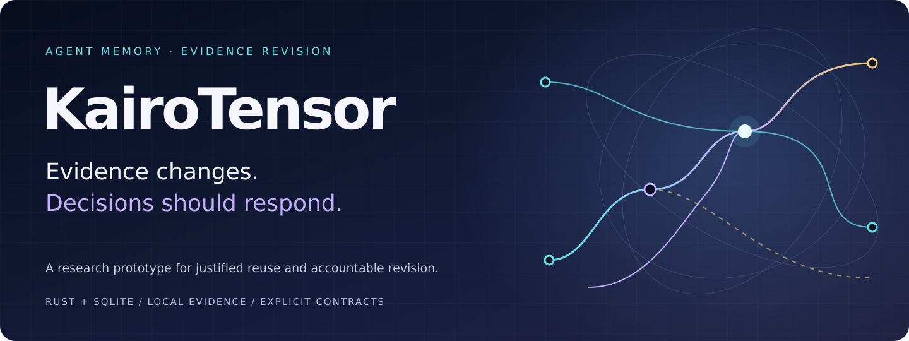
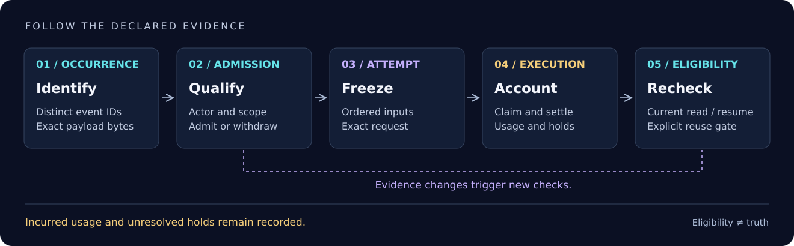

<p align="center">
  
</p>

# KairoTensor

**Evidence-grounded revision for agent memory.** A Rust and SQLite research prototype for deciding when an agent's stored work remains eligible after its declared evidence changes.

[Read the paper](docs/submission/kairotensor-report.pdf) · [Inspect the evidence](docs/submission/EVIDENCE.md) · [Explore the contracts](docs/README.md) · [Run the examples](#run-it-locally)

[](https://github.com/k2jac9/kairotensor/actions/workflows/check.yml)

**Alejandro Castellanos · Independent Research**<br>
AI × Epistemics Research Sprint, November 2026 · Trust Infrastructure

> **Research question**<br>
> When evidence changes, can an agent retire conclusions that have lost their declared support, preserve work that remains eligible, and account for the cost of correction?

## The moment a decision goes stale

A deployment agent reads a test report, judges the result, and chooses a release plan under a policy. Then the policy changes.

The plan needs revision. The test-report judgment may still be reusable under an explicit contract. If the **report itself** is replaced, that judgment needs fresh computation. If support disappears, the appropriate outcome can be **unsupported**; withdrawal does not establish the opposite proposition.

KairoTensor records that distinction at the execution boundary. It captures ordered evidence occurrences, freezes the adapter request, checks publication and subsequent access, and retains usage when attempted work becomes stale or invalid.

<p align="center">
  
</p>

*Conceptual lifecycle, not a performance plot. Timed recovery has additional reserve, claim and runtime checks; a diagram or stored receipt grants no dispatch authority.*

## What the system contributes

| Layer | Implemented behavior | Contract |
| --- | --- | --- |
| **Evidence and eligibility** | Distinct acquisition occurrences, scoped admissions, current-read checks and explanations without payloads. | [Current eligibility](docs/current-eligibility.md) |
| **Atomic correction** | Expected-epoch admission batches; changed support verdicts publish once against the final view. Unchanged verdicts retain their attempt and charge. | [Atomic correction](docs/atomic-correction.md) |
| **Explicit reuse** | Same-branch reuse of an accepted model response with matching versioned contract, ordered candidates/inputs, request bytes and admission history. | [Scoped model reuse](docs/scoped-model-reuse.md) |
| **Execution and accounting** | Frozen requests, token reservations, durable send claims and deadline checks. Potentially sent work retains its hold until reconciliation permits settlement. | [Runtime boundary](docs/recovery-runtime.md) |
| **Replay and policy** | Authorized decision export, offline recorded validation, and evaluated policy activation with revision checks. | [Decision replay](docs/decision-replay.md) · [Policy promotion](docs/policy-promotion.md) |

These are application contracts over **declared dependencies**. Eligibility does not establish truth, authenticate the source, discover omitted inputs, or reveal what a model internally attended to. The embedding runtime authenticates actors and diagnostic access; the caller validates outputs and reports usage. A historical accepted receipt does not grant current access.

## What we measured

The paper reports the frozen source [`20fab84`](https://github.com/k2jac9/kairotensor/tree/20fab84a6baa525452191ecf80eeee339f0b5ac7). Later reliability features are integrated into the current repository and remain separate from those measurements.

| Experiment | Observation | Interpretation and limit |
| --- | --- | --- |
| **Atomic revision** | **13.46×** median paired edit-time speedup for 32 dense edits across 128 rules, versus per-branch revision; six paired trials. | The lighter full scan had the lowest **total** time in all 30 matched trials. History contracts differ. [Protocol and samples](docs/revision-benchmark.md) |
| **One model correction** | **193 vs 404 tokens**, one new call versus two; both routes produced the same checked plan. Replacing the report forced fresh judgment. | One synthetic observation per route after a prompt revision. The earlier prompt produced a rejected error. No estimate of typical savings. [Prompts and traces](docs/scoped-model-reuse.md) |
| **Frozen recovery** | **0/6 held-out successes** for each of three policies. All responses violated the strict JSON contract; all retry receipts were late. | Policies replayed shared trajectories. These are failures of this model/validation/deadline arrangement, not independent policy arms. [Recorded evaluation](docs/evaluations/recovery-policy-v2-2026-11-14.md) |

A [later controlled correction pilot](docs/controlled-correction-results.md) reports four synthetic changes: post-change repair used four calls and 751 reported tokens; fresh recomputation used six calls and 1,167 tokens. It uses a different model/runtime, is outside the paper, and does not establish population accuracy or latency savings.

**The evidence supports a working mechanism, measured implementation tradeoffs, and bounded examples of reuse. It does not establish generally more accurate or trustworthy agent decisions.**

## Run it locally

Use the pinned Rust toolchain in `rust-toolchain.toml`, Cargo, and a C compiler for bundled SQLite. These examples use deterministic fixtures and make no model or provider calls:

```sh
cargo run --locked --example withdrawal
cargo run --locked --example selective_revision
cargo run --locked --example incident_store_bridge
```

In `withdrawal`, two shelf reports initially support a total of 12. Withdrawing the second report makes the old total unavailable for current reads and resume. A fresh attempt returns 8. Work that finished too late remains in the ledger: five additions across the three attempts.

For the full local contract suite and the independent reference/oracle checks:

```sh
cargo test --locked --all-targets
python3 -m unittest discover -s reference -p test_memory.py
python3 reference/belief_oracle.py
```

The [CI workflow](.github/workflows/check.yml) also runs the Python scripts and fixture integration stages across pinned stable, upcoming and previous runtime lanes. The badge links to current results; fixture passes are not live model-performance evidence. On this owner's workstation, use the [qualified launcher and storage workflow](docs/runtime-adoption.md) before heavy builds.

## Why this is an epistemics problem

An answer can remain in memory after its justification changes. Durable provenance helps identify the supplied evidence; revision rules determine which saved work may still be used. KairoTensor studies their integration with exact model requests, conservative continuation checks and accounting for failed or superseded work.

This builds on established ideas in [truth maintenance](https://doi.org/10.1016/0004-3702(79)90008-0) and [assumption-based truth maintenance](https://doi.org/10.1016/0004-3702(86)90080-9). The contribution under study is an execution-boundary integration, not a new truth-maintenance formalism. See the paper's [related work and limitations](docs/submission/report.md#2-related-work).

## Research map

| If you want to… | Start here |
| --- | --- |
| Review the sprint submission | [Paper](docs/submission/kairotensor-report.pdf) · [Editable manuscript](docs/submission/report.md) · [Reviewer guide](docs/submission/README.md) |
| Trace a claim to raw evidence | [Evidence index](docs/submission/EVIDENCE.md) · [Benchmark CSVs](docs/benchmarks/) · [Evaluation records](docs/evaluations/) |
| Understand or embed the Store | [Contract guide](docs/store-guide.md) · [Documentation index](docs/README.md) |
| Inspect the semantic integration | [Store-backed incident bridge](docs/incident-store-bridge.md) · [Frozen workload](docs/incident-routing-workload.md) |
| Audit later reliability work | [Review guide](docs/reliability-review-guide.md) · [Dated submission status](docs/submission/CURRENT_STATUS.md) |

Next research steps are controlled comparisons after evidence changes, equally durable baselines, broader task families, and independently measured model execution. Hosted adapters and AutoScientist work do not become paper results merely by existing or finishing.

## Authorship and disclosure

Alejandro Castellanos confirms that no KairoTensor-specific ideas, code or experiments predate the 13–15 November 2026 sprint. Third-party dependencies and prior work remain identified in their manifests and citations. AI assistance supported development and writing; the author is responsible for the claims and submission. See the paper's [provenance, ethics and LLM usage statements](docs/submission/report.md#appendix-limitations-and-dual-use--ethical-considerations).
