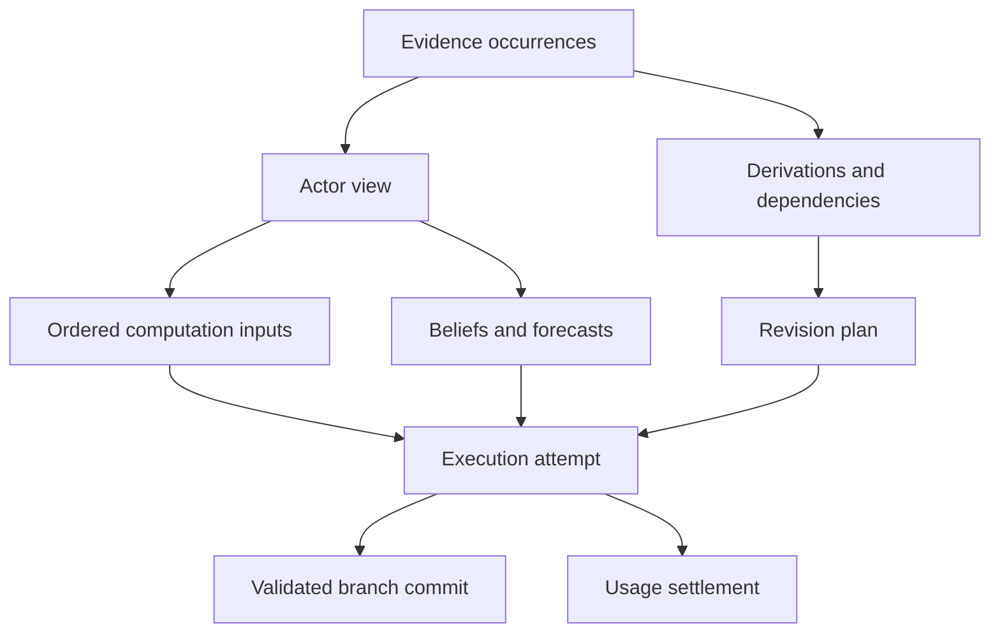

# Versioned Evidence Memory v0

**Date:** 13 November 2026, America/Toronto
**Decision:** Create a project-specific memory abstraction and reference contract.
**Status:** Proposed production design with a small executable contract model. This is not an integrated Rust runtime, a new database engine, or an experimentally validated performance claim.

## 1. The decision and its scope

Create a memory component whose central operation is revision: when evidence changes, determine which results remain supported, which computations need reconsideration, and which attempted transitions can still commit.

Its unit of reuse is a value together with its recorded basis. That basis identifies the evidence occurrences, actor view, exact submitted inputs, rule or model version, and any query/configuration dependencies relevant to its derivation. Arbitrary LLM claims remain assertions until checked under a declared validation procedure.

The custom work is the object model, operations, invariants, and conformance fixtures. SQLite supplies local transactions. Existing hash implementations identify encoded objects. Ordinary maps supply the first working-state representation. MCAP is an eventual recording/export adapter. This follows the latest architecture cross-examination [D1].

### Approaches considered

| Approach | Benefit | Main cost | Decision |
|---|---|---|---|
| Configure an existing retrieval/memory service | Fast retrieval integration | We still need precise actor views, withdrawal semantics, attempt identity, and commit accounting | May become a retrieval adapter |
| Implement our own semantic memory component on SQLite | Direct control over the required contract with an inspectable foundation | We own the reducer, schema evolution, and validation | Recommended |
| Invent a binary layout and storage engine immediately | Maximum layout control | Recovery, indexing, compatibility, and transactions become another project | Reconsider only after measured limits |

This recommendation does not establish academic novelty. Provenance, incremental computation, temporal data, and optimistic validation have substantial prior art. The research question is whether their integration improves agent revision, completion, and total cost under the declared workload.

## 2. What the memory must answer

1. What was captured, and what exact bytes or absence description were recorded?
2. Which actor could use which version at a decision boundary?
3. What was actually submitted to a computation, in what order?
4. Which records jointly or alternatively support a conclusion?
5. Which beliefs and forecasts were conditioned on that evidence?
6. What changes when a source, permission, rule, or retrieval result changes?
7. Can an in-flight result still commit, and what did its attempted work cost?

The first application is the current agent handoff and computation-allocation project. Shared record contracts may later serve NOEMA or other runtimes. Generalization should follow a second real adapter, not precede the first working vertical slice.

## 3. Logical structure

Treat the memory state as:

\[
M=(J,O,G,V,H,B,U,I).
\]

| Component | Meaning | Authority |
|---|---|---|
| J | Ordered local journal of recorded events and dispositions | Durable facts about what the runtime recorded |
| O | Immutable payloads and typed manifests | Exact retained bytes |
| G | Derivation and computational dependency graph | Versioned declared relationships |
| V | Actor/scope admission history and captured evidence views | Eligibility under a specified policy and cutoff |
| H | Branch heads and monotonic revisions | Accepted continuation state |
| B | Belief and forecast artifacts | Derived estimates under declared models |
| U | Attempt usage, reservations, and settlement records | Accounting for actual and unresolved work |
| I | Search, reverse-dependency, and analytical indexes | Rebuildable projections |

This is a family of typed records and operations. It need not be held in one enormous in-memory graph. Relational tables and indexed joins are sufficient for the initial representation.



## 4. The records we own

### 4.1 Payload and occurrence

An immutable object contains an encoding kind/version and payload bytes. Its content identifier hashes a typed, unambiguous, length-delimited preimage. Exact canonicalization rules belong to each structured encoding; a generic JSON serializer is not a complete cross-language canonicalization standard.

An evidence occurrence has its own identifier, source identity/revision, acquisition event, payload reference or explicit availability state, and origin links. Two independent measurements can have identical payload hashes. Three paraphrases can share a single observation origin. Neither content equality nor different UUIDs establish independence.

For a production wire contract, use separate namespaces or typed wrappers for artifact, observation, invocation, attempt, and commit IDs. Scope deduplication to the security boundary: content-addressing must not become an unauthorized existence oracle across tenants.

### 4.2 Actor view and submitted context

Admission and revocation are events relating an actor and scope to evidence versions. An artifact's mere presence in storage does not admit it.

A captured view identifies the actor, scope, monotonic view epoch, policy/configuration version, capture cut, and explicit evidence manifest. The journal's local ordering is not a physical total order across distributed sources.

The submitted-input manifest records the selected messages or tool inputs in exact order and references the view from which they were selected. Evidence can be admitted without being selected. Captured input bytes do not establish the model's internal influence pattern.

Freeze this manifest after client-side request assembly: context selection, rendering, truncation, system messages, tool schemas, ordering, and relevant parameters. Dispatch the frozen request representation and record its object ID. A subsequent change requires a new representation before dispatch. Exactness is at the client-visible API input boundary; unobserved provider-side transformations are outside that claim. Record dependencies of request assembly and retrieval as well as the evidence selected into the final request.

Historical reconstruction and present authorization are different checks. Possessing an old snapshot ID must not authorize serving withdrawn payloads today. A diagnostic may report that a historical view contained an evidence ID without granting access to its bytes.

### 4.3 Claim and derivation

A claim version identifies a proposition and scope. A derivation records a declared rule/version and a set of jointly required premises. Alternative derivations are separate objects. Keeping both kinds of structure gives an AND/OR hypergraph, or a bipartite DAG with explicit derivation nodes.

Require an acyclic graph of evidence and derived occurrences in v0. Distinct occurrences of the same claim may share its proposition identifier without becoming the same proof node. A cycle of claims repeating each other must not sustain itself after its originating evidence is withdrawn. Explicit versioned axioms, if permitted, are separate from accidentally empty premise lists.

Example:

\[
C\Leftarrow(A\land B)\lor D.
\]

A supports-with edge alone cannot express that A and B must be present together while D is independently sufficient. Symbolic provenance supplies established semantics for joint and alternative use in positive query languages [S3]. Our application must define which rules are actually validated.

Withdrawal of A leaves the D derivation available if its evidence and rule remain applicable. Withdrawal of all positive premises yields no active support. It does not establish the negation of C.

Keep positive and negative derivation families separately. Their presence gives four descriptive evidence states:

| Positive support | Negative support | Status |
|---|---|---|
| Absent | Absent | Neither established |
| Present | Absent | Supported only |
| Absent | Present | Refuted only |
| Present | Present | Conflicting support |

These are evidence-status labels, not an automatically implemented complete logic. Model-generated support formulas remain asserted provenance until checked. The reference SQLite model intentionally implements only positive, one-level OR-of-AND support; the mathematical oracle illustrates the four-status query separately.

### 4.4 Support and computational freshness

A previously observed claim can retain an admissible supporting derivation while its old computation no longer answers the current query.

Examples:

- A sum derived from rows A and B can become stale when C is added to the query's result set.
- A successful existence proof can survive an irrelevant new row.
- A top-k search can change when a new document is indexed even though every previous result is unchanged.
- A rule version can be retired while every premise is still admitted.

Store logical support, computational freshness, access eligibility, and execution lifecycle separately. Query dependencies include predicates, absence, membership, ranking/index versions, rules, and policy. In v0, a coarse applicable-view epoch invalidates all in-flight work in that view when these may change. Fine-grained skipping is a later optimization.

For an opaque execution, record computational dependence on every submitted input plus the declared selection, query, model, and configuration dependencies. A model's citations or asserted support formula cannot narrow that basis. If the model received A and B but cited only A, withdrawal of B still invalidates the original computation under the conservative rule. An independent proof may establish a separate derivation for the same conclusion; it does not rewrite the execution's history.

**Current read/resume gate:** changing the applicable view also removes the default eligibility of already committed derived results, app-state continuations, beliefs, and executor checkpoints that were certified under the earlier view. Historical acceptance remains recorded. Before returning such an object as current, or using it as inherited state for a new attempt, validate or rebuild its complete basis for the requesting actor's current view. Mark it `needs_review` until that succeeds. Do this even if a background revision worker has not run yet.

A new attempt ID and a new epoch capture do not cleanse old state. Revalidation must produce a new eligibility certificate or derivation with checked lineage, not merely overwrite an epoch field. A revision attempt may deliberately rebuild from raw active sources or a clean checkpoint while using the old branch head only as the publication parent. A surviving exact derivation can sometimes be recertified without rerunning its calculation; arbitrary LLM continuations need a conservative rebuild. The certificate's validity is at the declared capture/publication boundary, not a promise that external reality never changes afterward.

### 4.5 Belief and forecast

A belief references its state space, prior/model version, active evidence-factor manifest, estimator configuration, target time, and evidence cutoff. Its numerical representation is separate from its meaning.

A forecast additionally defines its outcome, horizon, action scenario, issuance time, and eventual resolution rule. A retrospective reconstruction links to later evidence and never overwrites the forecast issued before that evidence became available.

The initial representation is an inspectable finite categorical distribution. A model may later select particles, Gaussian parameters, a shared decision circuit, or a tensor representation. The backend must declare its supported queries and guarantees; these are not interchangeable encodings of arbitrary state without further assumptions.

### 4.6 Attempt, branch, and accounting

An attempt identifies an actual execution occurrence. It captures branch head, monotonic branch revision, actor view epoch, invocation specification, ordered inputs, configuration, and a bounded reservation when resource control is implemented.

A commit identifies an accepted transition. Identical output bytes do not make two executions the same attempt. A cache may reuse deterministic work under a declared reuse contract; returning one sampled answer as several independent draws changes the experiment.

The resource ledger retains accepted, rejected, canceled, and unresolved work. A rejected candidate cannot roll back its incurred costs. Late usage remains linked to the original attempt. External effect exactly-once semantics are outside the initial pure-calculation/versioned-read scope.

## 5. Operations and Rust boundary

Use one internal Rust module or crate first. Split storage, statistics, or adapters into crates only when their interfaces and independent consumers justify it.

The intended API is:

| Operation | Result |
|---|---|
| observe | Immutable evidence occurrence and payload reference |
| admit / revoke | Admission event and a new applicable-view epoch |
| capture_view | Immutable manifest of actor-eligible evidence at a boundary |
| derive | Claim/derivation version with its rule and dependency basis |
| read / explain | View-qualified result, active derivations, and revision status |
| begin_attempt | Captured parent/view and exact submitted inputs |
| revise | New view plus affected-consumer and continuation-rebuild plan |
| commit_candidate | Durable accepted or rejected disposition and usage settlement |
| fork | New branch from a captured state with explicit view inheritance |
| forecast | New prediction artifact linked to a belief and action scenario |

Illustrative Rust types, not compiled production code:

```rust
struct Derivation {
    conclusion: ClaimVersionId,
    rule: RuleVersionId,
    premises: Vec<PremiseRef>, // all jointly required
    polarity: Polarity,
    validation: ValidationRef,
}

struct ComputationBasis {
    actor_view: ViewManifestId,
    ordered_inputs: InputManifestId,
    dependencies: DependencyManifestId,
    program_or_model: VersionId,
    query_and_configuration: ObjectId,
}

struct MemorySnapshot {
    branch: BranchId,
    head: CommitId,
    branch_revision: u64,
    evidence_view: ViewManifestId,
    app_state: ObjectId,
    belief: Option<BeliefId>,
    executor_checkpoint: Option<CheckpointId>,
}
```

An executor checkpoint is separate from application memory. A map snapshot does not restore KV tensors, recurrent state, external side effects, or elapsed time.

## 6. Revision and transaction semantics

### Read and compute

Capture the view and branch consistently, persist the attempt, and release the write transaction. Model/tool execution runs outside it. SQLite supports isolated transactions and serializes writes, but application-level freshness checks remain necessary after long computation [S1, S2].

### Publish

A candidate is eligible only if its recorded parent head and branch revision still match, its applicable-view epoch matches the declared query semantics, its validation is accepted, and the run/authority/budget conditions hold. Required object bytes must already be durable.

Inside a short writer transaction:

1. Recognize an identical already-settled delivery and return its prior disposition.
2. Reject conflicting reuse of an attempt or delivery identity.
3. Validate the captured dependencies.
4. Persist accepted or rejected disposition with usage.
5. Advance the branch only for an accepted transition.
6. Append any export/outbox item.

The global journal tip is not a freshness precondition. Logging unrelated work must not invalidate every running candidate. A monotonic branch revision prevents old candidates from passing after the head changes and is restored to its former value.

An old view is an information-cut record, not a perpetual authorization grant. Current-view and historical as-of query targets must be explicit. The small executable model uses current-view validation and rejects a changed coarse epoch.

### Revision plan

Find candidate consumers using reverse dependencies. Determine which derivations survive, mark computations whose inputs or query meaning changed, and build a new continuation from an appropriate boundary. Retain old records for audit subject to retention policy. Replaying the identical stale transcript into a cleared model cache is not a semantic revision.

For deterministic versioned functions, the proposed correctness objective is:

\[
\operatorname{Revise}(F,E,\Delta E)=F(E\oplus\Delta E).
\]

Incremental computation has established from-scratch consistency results under specified languages and effect models [S4]. Our fixture suite does not extend those proofs to arbitrary LLMs. Distinguish event replay, deterministic recomputation, and fresh stochastic generation.

## 7. Mathematical memory

Under a declared valid factorization:

\[
b_E(x)\propto b_0(x)\prod_{s\in E}L_s(x).
\]

The distribution depends on the prior, model, active evidence identities, and likelihood factors. Merely storing reports separately does not justify multiplying them. Copied reports should reference a common evidentiary origin; correlated independent acquisitions may still require a joint likelihood.

Withdrawal rebuilds from the prior or a valid checkpoint and the remaining factors. The checkpoint's lineage must exclude the withdrawn evidence, or an independently justified correction must remove its contribution; starting from a checkpoint that already incorporated it preserves its influence. For prior (1/2,1/2) and factor (0,1), conditioning yields (0,1); removing the factor restores (1/2,1/2). A posterior alone can lose the information required to reverse an update. If all states get zero likelihood, report model inconsistency rather than inventing a normalized posterior.

For an optional compressed representation q approximating reference p on the same finite state space, total variation at most epsilon implies expected bounded-utility error at most epsilon for each fixed action. Choosing an exact maximizer under q incurs at most min(1,2 epsilon) regret under p for payoffs in [0,1]. This is a one-decision reference-model statement. It does not certify calibration, model truth, or an adaptive sequence. An epsilon compression tolerance in another norm is not automatically this bound.

Separate numerical error, sampling error, state/parameter uncertainty, and model discrepancy in stored diagnostics. A continuous distribution and a finite empirical particle distribution may require observable-specific metrics rather than total variation.

## 8. Quantum inspiration in its proper place

| Idea | Transfer | First status |
|---|---|---|
| Measurement instrument | Outcome-indexed state update with declared observation procedure | Interface design |
| Trajectories | Alternative histories, weights, sample ancestry | Optional estimator |
| Weighted decision diagrams | Share identical conditional subfunctions | Benchmark after exact baseline |
| Gaussian state representation | Mean/covariance for suitable continuous variables | Distribution-fit dependent |
| Tensor trains/MPS | Structured joint-state compression | Rank/query-fidelity dependent |
| Process memory | Explicit relevant history and action effects | Later model comparison |

Graph structure is reusable without claiming a quantum mechanism. Decision diagrams share repeated structure but have no general compactness guarantee [S5]. Content hashes do not provide probability independence, and phase/coherence terminology does not explain ordinary uncertainty about software evidence.

## 9. Storage, indexes, and retention

Use SQLite as the first authority; small payloads may remain in it. Use ordinary indexes for actor/scope admissions, current branch state, reverse dependencies, and attempts. Keep a consistent transaction boundary around state publication and disposition recording.

A vector index, if added, proposes retrieval candidates. Eligibility checks and exact object resolution determine what can be returned. Filtering only the prompt after an unauthorized payload has already reached the actor is too late. Search indexes and projections must respect withdrawal and retention operations.

MCAP can carry the profile's committed records and attached schemas [S6]. It does not become the commit authority. Arrow/Parquet views are additional derivatives when cross-run analysis needs them.

Immutability is a versioning convention, not a promise to retain private payloads forever. Production retention needs references, tombstones, legal deletion behavior, backup/cache handling, and a declared audit boundary. The reference model has no retention or access-control enforcement and must not be exposed as a user-facing service.

## 10. Implementation and evaluation sequence

1. Freeze identifiers, views, occurrences, derivations, attempts, and dispositions.
2. Port the bounded transaction/manifest reference to Rust and add schema migrations, current read/resume eligibility, authorization checks, reservations, and the crash/retry contract.
3. Add a deterministic dependency reducer and compare selective revision to fresh recomputation on small exact workloads.
4. Connect one real model adapter with bounded submitted context, cancellation, and explicit continuation rebuilding.
5. Add empirical forecasting and computation selection after outcomes, cutoffs, and usage are reliable.
6. Compare map copies against persistent maps, exact beliefs against shared circuits/particles, and tensor compression only where measurements justify it.

The first vertical slice is source revision -> affected-consumer identification -> preserved alternate support -> rebuilt continuation -> new belief/forecast -> stale-candidate rejection -> durable cost accounting.

Measure revision correctness, reference-equivalence where applicable, total attempted work, completion success, latency, memory, and forecast scores separately. Include dependency construction, provenance retention, view invalidation, and controller overhead. An attractive compression ratio cannot substitute for accurate decisions.

## 11. What the accompanying code establishes

The bundle contains a Python/SQLite executable contract model and a small exact-rational belief oracle. Python is used because the available environment has Python/SQLite and no Rust compiler. The intended production implementation remains Rust-first.

The SQLite model exercises selected actor-view, support, identity, stale-promotion, and usage-disposition behavior. The oracle checks tiny finite probability and bounded-decision examples. The verification report lists commands and observed outcomes.

It does not implement the complete design above: no real LLM integration, authorization service, resource reservation controller, retention engine, general derivation logic, incremental transcript repair, distributed protocol, physical timing prediction, tensor backend, or MCAP adapter. Its branch head is an opaque publication token: there is no inherited app-state/LLM continuation or current-result-serving API, so the full current read/resume gate and clean-checkpoint qualification are specification requirements, not verified implementation features. Caller-supplied context is recorded, not proven free of withdrawn information. Withdrawal does not unlearn information already present in a pretrained model's parameters. The model provides contract fixtures for the next Rust implementation and exposes counterexamples before that integration.

Passing these tests is evidence for the enumerated cases. There are no measured speedups, calibration improvements, production durability qualifications, or scientific novelty claims.

## References

- **D1.** Architecture, Memory, and Mathematics: Cross-Examination. Internal project design audit, 13 November 2026.
- **S1.** SQLite, [Isolation](https://www.sqlite.org/isolation.html). Transaction visibility and serialized writers.
- **S2.** SQLite, [Transactions](https://sqlite.org/lang_transaction.html). Explicit transactions and BEGIN IMMEDIATE behavior.
- **S3.** Karvounarakis and Green, [Semiring-Annotated Data: Queries and Provenance](https://www.sigmodrecord.org/publications/sigmodRecord/1209/03.principles.karvounarakis.pdf), 2012. Joint and alternative source use in positive query semantics.
- **S4.** Acar, Blelloch and Harper, [Adaptive Functional Programming](https://www.cs.cmu.edu/~blelloch/papers/popl02.pdf), 2002. Dependency tracking and from-scratch consistency under the specified language model.
- **S5.** MQT, [Decision-diagram package](https://mqt.readthedocs.io/projects/core/en/latest/dd_package.html). Shared nodes/caches and representation limits.
- **S6.** [MCAP specification](https://mcap.dev/spec). Record structures, schemas, profiles, and indexes.

The architecture, types, operation set, and implementation sequence in this document are our proposed integration. The references substantiate the underlying mechanisms, not performance of the proposed memory.
